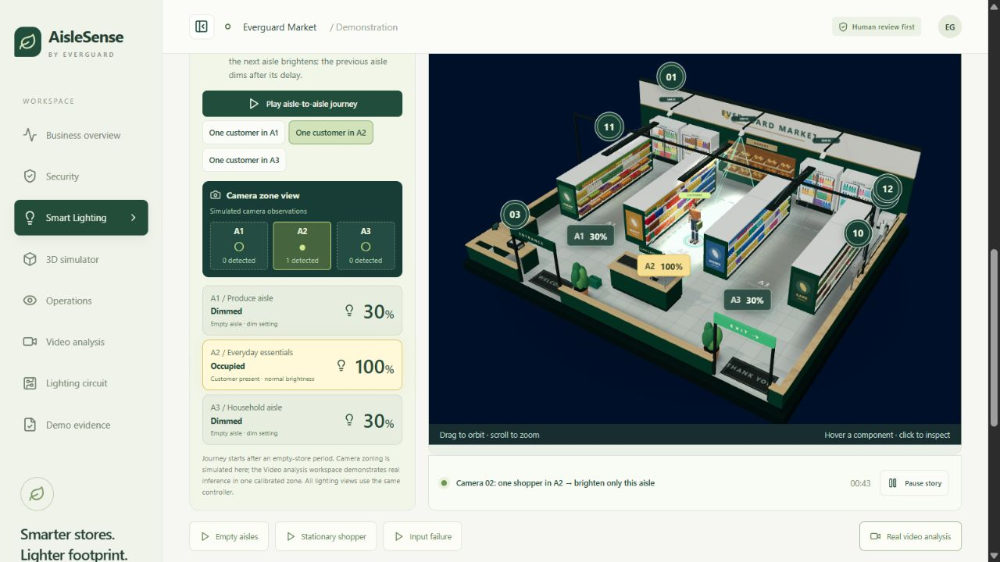

# AisleSense

**One camera input. Two smarter store services.**

AisleSense is Team Everguard's retail demonstration for **Smart City and Green Technology**: explain a security event, let staff review its evidence, and adapt aisle lighting to occupancy. This is Kisara Wethmin's portfolio copy of the team project, based on [Pasindu's improved version](https://github.com/PasinduHima/AisleSense-demo). See [team and resource credits](ATTRIBUTION.md).



*Actual application screenshot. Shoppers, camera observations and lighting hardware in this view are simulated.*

## Explore the system

- **Security demonstration:** a scripted multi-shopper supermarket, low/medium/high review stages, guard response, camera viewpoints, simulated pose overlays and playback controls.
- **Recorded-video analysis:** MediaPipe Pose Landmarker Lite runs locally on a supplied ordinary-shopping clip. A timed region-entry rule produces an observation and a reviewable clip.
- **Human review:** decisions and notes persist in SQLite. Risk levels request attention; they do not establish theft.
- **Smart lighting:** independent aisle occupancy, delayed dimming, safe brightness on input loss and a synchronized planned-circuit view.
- **Interactive explanation:** rotatable Three.js store, component cutaways, animated 2D flows and simulation-only full screen.
- **Cost example:** editable electricity price and opening hours, with system power overhead included.

## Run locally

Verified target: **Windows, Python 3.13 and Node.js 24**. Internet is needed for first-time dependency/model setup. The prepared demo then runs locally without internet; optional attribution links remain external.

```powershell
git clone https://github.com/Kisara00555/AisleSense.git
cd AisleSense
py -3.13 scripts/setup.py
```

Then double-click **Start Business Dashboard.cmd**, or run:

```powershell
.\.venv\Scripts\python.exe launch.py --system
```

Keep the launcher running; use **Ctrl+C** there to stop. Open `http://127.0.0.1:8765/?view=system`. If another version is already running on that port, stop its own launcher first so you do not accidentally view the older build. Refresh your browser after rebuilding.

The setup script creates a fresh environment, installs pinned dependencies, builds the frontend and downloads a hash-checked model. The included sample is credited in [SOURCES.md](SOURCES.md). No old database, user uploads, review clips, local environment or build output is committed. A new database is created automatically on first run.

## Demo route

1. Open **Security → Run demo scenario**. Try pause/play and speed; **Store walkthrough** also offers camera presets. Simulated skeletons and scores illustrate the idea; they are not model inference.
2. Open the current event to review its trace and save a decision.
3. Choose **Analyse recorded sample** for genuine local pose processing and a neutral movement observation with a clip.
4. Open **Smart Lighting** and choose one customer in A1/A2/A3. Only the occupied aisle is fully bright in these examples. The multi-person security scenario separately uses 80% occupied lighting and 100% evidence boost.
5. Run the aisle journey, inspect a selected aisle in **Lighting circuit**, and use **Full screen demo** to enlarge only the 3D scene.

See [PROJECT_GUIDE.md](PROJECT_GUIDE.md) for more detail and [SECURITY_MODEL.md](SECURITY_MODEL.md) for the model and rules.

## Example costs, not measured savings

For three 60W aisles at 30%, 100%, 30%, with 15W system overhead, 12 hours/day, 30 days/month and an **illustrative LKR 300/kWh**:

| Metric | Example |
|---|---:|
| Net power reduction | 69W / 38.3% |
| Monthly net energy saving | 24.84kWh |
| Always-on monthly lighting cost | LKR 19,440 |
| Adaptive lighting + system cost | LKR 11,988 |
| Monthly / annual example saving | LKR 7,452 / LKR 89,424 |

The example holds that brightness pattern constant. It is not a verified electricity tariff, measured store bill reduction or return-on-investment claim. Installation costs, taxes and other charges are excluded.

## Stack and checks

React 19 · TypeScript · Vite · Three.js · FastAPI · SQLite · MediaPipe · OpenCV

```powershell
.\.venv\Scripts\python.exe -m pytest tests -q
node --experimental-strip-types --test tests/savings.test.mjs
npm run build
```

See [VALIDATION.md](VALIDATION.md) for publication checks and their limits.

## Current boundary

This is a local educational demonstration, not a production surveillance product. Live CCTV/NVR and POS integration, physical electrical hardware, production authentication and representative concealment validation are not implemented. The real pose pipeline is configured for one person; multiple people and COCO-style 17-point overlays in the 3D scene are scripted. The experimental shelf-to-bag rule is not a validated theft classifier. The normal-shopping sample must not be portrayed as misconduct. Keep the service on localhost; it is not designed for public hosting.

No blanket license has been added to team-owned code; resource notices and attribution are preserved. See [ATTRIBUTION.md](ATTRIBUTION.md).
